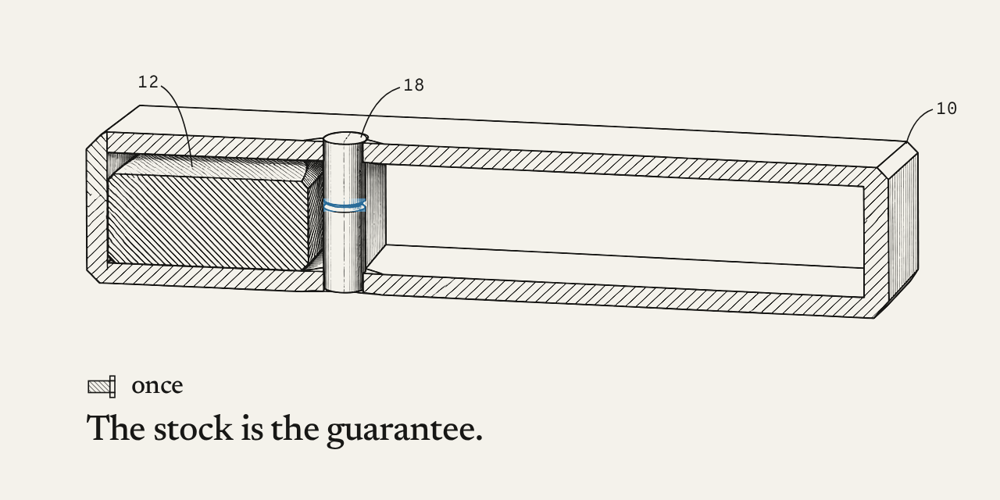

# once

A Solana program in which a call option holds the tokenized stock it promises. The writer puts the stock in when the call is written. The holder pays the strike once, before expiry, and the stock and the USDC change places in one transaction.

Program `GRzKU9i3Cs7A5Euf9gGZjbRnpypw7DzaU3hWRfUgpYTa` on Solana mainnet.

callonce.xyz is the specification: it draws the device and states six claims. This repository is the device. Each claim below names the code that holds it and the test that checks it, and the program on mainnet is the deterministic build of this code. A claim can be checked here instead of taken from the page.

## Claims

**1. A call option that holds, from the slot it is written, the exact raw amount of stock it promises.**

Held by `write` in `programs/once/src/lib.rs`. The lot moves into the vault, a token account at `["vault", call]` whose authority is the call account. The write fails with `DepositMismatch` unless the vault then holds exactly the lot. `buy`, `lock_and_buy` and `call` fail with `VaultShort` if the vault holds less.

Checked by `P7 all 12 mainnet mint layouts: exercise, cancellation, expiry reclaim` and `P8g permanent delegate depletion blocks payment; writer receives the remainder`.

**2. The call of claim 1, released by a single payment of a fixed total strike in USDC, after which it cannot be released again.**

Held by `call` in `lib.rs` and its accounts, `Exercise` in `contexts.rs`. Only the holder signs it, and only while the call is `Held`. In one instruction the strike moves from the holder to the writer, the whole vault moves to the holder, the vault closes and the state becomes `Exercised`. A second `call` fails.

Checked by `P4 expiry boundary, writer and holder authorization, final states`, `P6 exact rent refunds, fee losses, and event fields`, and `P8d/e atomic exercise when writer payment ATA is close` and `… is reassign`.

**3. The call of claim 1, which reads no price at any step and leaves nothing to clear.**

Held by `contexts.rs`, which lists every account each instruction takes. None is a price feed or an oracle. Time comes from the chain clock. Once `call`, `cancel` or `reclaim` runs, the vault is closed and nothing is owed to anyone.

Checked by reading `contexts.rs`: an absence is shown by the account lists, not by a test. `P6 exact rent refunds, fee losses, and event fields` checks the exact USDC, rent and fees each side ends with.

**4. The call of claim 1, in which the stock returns to the writer only when the call expires unexercised or is canceled before it is bought.**

Held by `cancel` and `reclaim` and their accounts in `contexts.rs`. `cancel` takes only an `Open` call, signed by its writer. `reclaim` is signed by the writer and runs only once the chain clock reaches `expiry_ts` (`NotExpired`). `call` stops at the same moment (`Expired`). No other instruction moves the stock in a vault.

Checked by `P4 expiry boundary, writer and holder authorization, final states` and `P2 admin cannot exercise, cancel, reclaim, or return another wallet lock`.

**5. The call of claim 1, which cannot be bought before ONCE is issued and, for `gate_slots` slots after writing or after ONCE is issued, whichever is later, can be bought only by a wallet that locks ONCE against it, the ONCE being returned whole.**

Held by `set_once`, `write`, `buy`, `lock_and_buy` and `return_lock`. Before the ONCE mint is set, both purchases fail with `OnceNotSet`. `set_once` stamps `gate_floor`, the registration slot plus `gate_slots`; a call written before it opens behind the gate until `gate_floor`. Once the mint is set, `write` stamps `gate_until`: the write slot plus `gate_slots`. `gate_end` selects the end for each call. Before that slot `buy` fails with `InGate`, and only `lock_and_buy` can buy. It moves `lock_amount` ONCE into a lock vault at `["lock_vault", call]`, records that end as the lock's `release_slot`, then pays the premium. From `release_slot` on, `return_lock` sends the whole lock vault back to the wallet that locked it, and to no other (`NotLocker`). One lock serves one call.

`gate_slots` is in the config account and callonce.xyz prints it. Changing it does not move `gate_floor`, an existing call's `gate_until`, or an existing lock's `release_slot`.

Checked by `half-open priority interval and duplicate purchase` and `first-slot lock and returns after exercise and reclaim`, each run with ONCE under the Token and the Token-2022 program; `P3 before ONCE registration both purchases fail; write, cancel and expiry reclaim remain available`; and `P3 pre-registration calls use the registration gate and return the whole lock`, run under both token programs with earlier-slot and same-slot writing. `v1 init only survives upgrade and set_once reallocates to 171 bytes` and `v1 init and an open call survives upgrade and set_once reallocates to 171 bytes` check the upgrade of existing accounts.

**6. The call of claim 1, written on any stock token whose mint passes the check at writing.**

Held by `validate_mint` in `programs/once/src/mint.rs`, which `write` calls. A Token program mint passes. A Token-2022 mint passes only with no transfer fee, no transfer hook program, and new accounts that do not start frozen. No list is kept by hand.

Checked by `P7 mint rejection matches client inspection; classic mint is accepted` and `P7 all 12 mainnet mint layouts: exercise, cancellation, expiry reclaim`.

## Parts

The numbers are the reference numerals in the drawings on callonce.xyz.

| | Part | On chain |
|---|---|---|
| (10) | housing | `Call` account at `["call", id]`, the id as a little-endian u64 |
| (12) | stock | the vault, a token account at `["vault", call]` owned by the call |
| (16) | strike | `Call.strike`, a total in raw USDC units for the whole lot |
| (18) | pin | `Call.state`: `Open` or `Held` while the stock is inside, `Exercised`, `Reclaimed` or `Cancelled` once it has left. No instruction sets it back |
| (24) | gate | `Call.gate_until`, or `Config.gate_floor` for a call written before ONCE was set |
| (28) | lock | `Lock` account at `["lock", call]` and its token account at `["lock_vault", call]` |
| (30) | holder's mark | `Call.holder` |
| (32) | ONCE | the mint in `Config.once_mint`; the config account is at `["config"]` |

## Instructions

| Instruction | Signer | When | What happens |
|---|---|---|---|
| `write` | writer | lot, strike and premium above zero, expiry in the future, the mint passes the check | Moves the lot, a whole number of raw units, into the vault, and fixes the total strike in USDC, the premium and the expiry time |
| `buy` | buyer | open, ONCE set, gate open, before expiry | Pays the premium to the writer; the buyer becomes the holder |
| `lock_and_buy` | buyer | open, gate shut, before expiry | Locks `lock_amount` ONCE against the call, then buys as above |
| `call` | holder | held, before expiry | Pays the strike to the writer; the lot moves to the holder; the vault closes |
| `cancel` | writer | open | Returns the lot to the writer; the vault closes |
| `reclaim` | writer | open or held, at or after expiry | Returns the lot to the writer; the vault closes |
| `return_lock` | locker | from the lock's `release_slot` | Returns all of the locked ONCE to the locker; the lock closes |
| `init`, `set_once`, `set_params` | upgrade authority, admin | | Configuration. None of them can move the stock in a vault or the ONCE in a lock |

Expiry is checked against the chain clock (`Clock::unix_timestamp`). The gate is counted in slots.

## What is left to trust

- The program has not been audited.
- It is upgradeable. The upgrade authority can replace its code, so the claims describe the program as it is deployed now. `solana program show GRzKU9i3Cs7A5Euf9gGZjbRnpypw7DzaU3hWRfUgpYTa` names that key.
- xStocks carry a freeze authority, a pause and a permanent delegate, and this program cannot remove them. A frozen or paused mint stops a call from settling. A permanent delegate can move the stock out of a vault; a call whose vault is short cannot be bought or exercised, and the writer takes back what is left.
- The gate narrows the race for a new call to wallets that hold ONCE. It does not end it: inside the gate, the first lock to land wins.

## Build and verify

The program on mainnet is the `solana-verify` build of this repository.

    cargo install solana-verify --version 0.5.2 --locked
    solana-verify build --library-name once
    solana-verify get-executable-hash target/deploy/once.so
    solana-verify get-program-hash -u https://api.mainnet-beta.solana.com GRzKU9i3Cs7A5Euf9gGZjbRnpypw7DzaU3hWRfUgpYTa

The two hashes are the same. Every push runs this build in GitHub Actions, runs the tests against the binary it built, and keeps the binary and its hash as the `once-verifiable-build` artifact.

## Tests

    npm ci
    npm test

The tests run in LiteSVM against `target/deploy/once.so`, so build first. They use copies of the twelve xStock mint accounts and the USDC mint, read from mainnet at slot 457 804 691 (`tests/fixtures/mints.json`). Before they run, `pretest` fetches the Token, Token-2022 and Associated Token programs from mainnet and stops unless each matches its hash in `tests/fixtures/programs.json`.

## Layout

    programs/once/src/lib.rs        the instructions
    programs/once/src/contexts.rs   every account each instruction takes, and the checks on it
    programs/once/src/mint.rs       the check at writing
    programs/once/src/state.rs      Config, Call, Lock
    programs/once/src/events.rs     the event each instruction emits
    client/                         TypeScript client generated from the IDL, with the same mint check and the exercise builder
    tests/                          LiteSVM tests
    scripts/scan-xstocks.ts         lists every xStock on Solana and runs the mint check on each

## Security

See SECURITY.md. The program's security.txt carries the same contacts.

---

The drawings and claims borrow the form of a patent document. Nothing here is a patent, a patent application, or a claim of priority.
